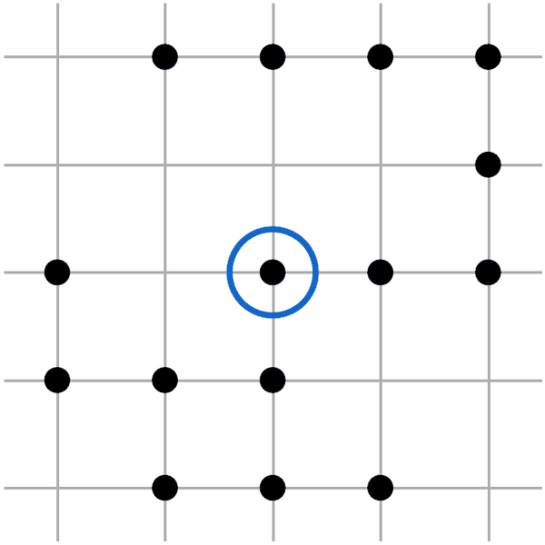
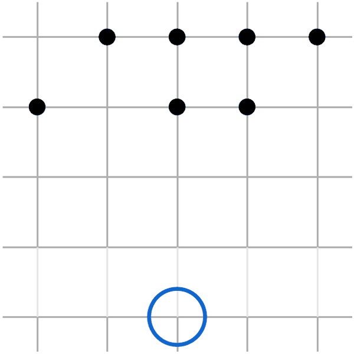

# Duality for time-inhomogeneous Markov processes

Animations accompanying the poster *Duality for time-inhomogeneous Markov processes*
by Frank Redig and Josephine Schikhof (TU Delft and DIEP), Stochastics Meeting Lunteren 2026.

In each pair, the left animation moves the particles and keeps the location fixed,
while the right animation keeps the particles fixed and moves the location (the dual walker, blue circle).

## 1. Time-homogeneous duality

| Moving particles, location fixed | Particles fixed, moving location |
|:---:|:---:|
|  |  |
| $\mathbb{E}[\eta_y(t) \mid \eta(0) = \eta]$ | $\mathbb{E}[\eta_{Y(t)} \mid Y(0) = y]$ |

## 2. Time-inhomogeneous: dual walker forward in time

The environment changes over time.
Letting the dual walker run forward in time, like the particles, does not give a duality.

| Moving particles, location fixed | Particles fixed, moving location |
|:---:|:---:|
|  |  |
| $\mathbb{E}[\eta_y(t) \mid \eta(s) = \eta]$ | $\mathbb{E}[\eta_{Y(t)} \mid Y(s) = y]$ |

## 3. Time-inhomogeneous duality: dual walker backward in time

The dual walker has to run backward in time, from time $t$ back to time $s$.

| Moving particles, location fixed | Particles fixed, moving location backward in time |
|:---:|:---:|
|  |  |
| $\mathbb{E}[\eta_y(t) \mid \eta(s) = \eta]$ | $\mathbb{E}[\eta_{\hat{Y}(s)} \mid \hat{Y}(t) = y]$ |
